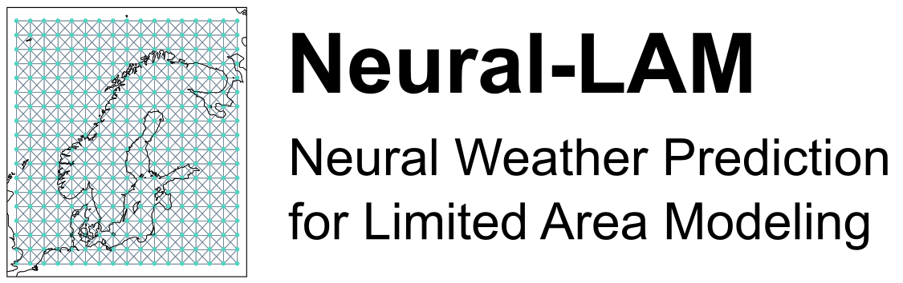
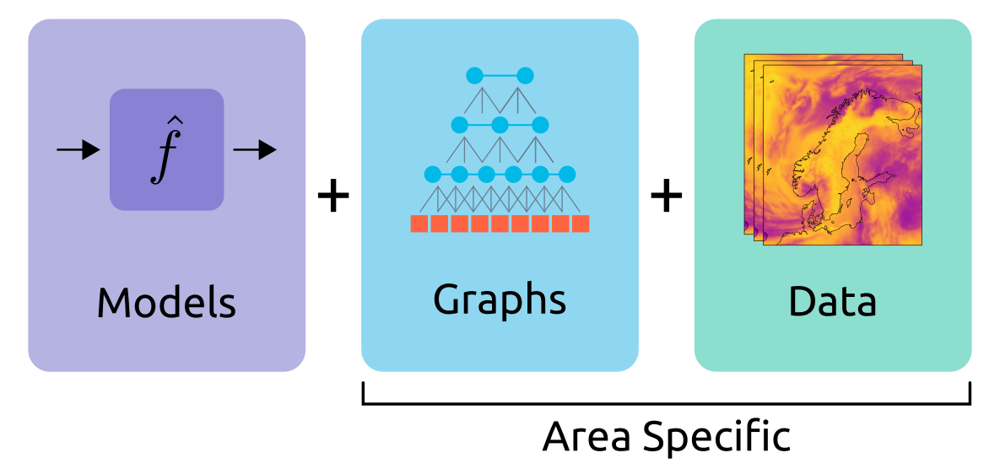

[](https://kutt.to/mllam)
[](https://github.com/mllam/neural-lam/actions/workflows/pre-commit.yml)
[](https://github.com/mllam/neural-lam/actions/workflows/install-and-test.yml)

<p align="middle">
    
</p>

Neural-LAM is a repository of graph-based neural weather prediction models for Limited Area Modeling (LAM).
Built on [PyTorch](https://pytorch.org/), [PyTorch Lightning](https://github.com/Lightning-AI/pytorch-lightning), and [PyG](https://pyg.org/), it provides modular, swappable components for data, graphs, and models.

It is aimed at researchers and engineers working on ML-based numerical weather prediction who want to train, evaluate, or extend GNN-based LAM models on their own data.

## Documentation

Full guides, tutorials, and API reference live at **[mllam.github.io/neural-lam](https://mllam.github.io/neural-lam/)**:

- 📦 [Installation](https://mllam.github.io/neural-lam/getting-started/installation.html)
- 🚀 [Quickstart](https://mllam.github.io/neural-lam/getting-started/quickstart.html) and the [DANRA tutorial](https://mllam.github.io/neural-lam/notebooks/hello_world_danra.html)
- 📖 User guide: [configuration and datastores](https://mllam.github.io/neural-lam/user-guide/datastores.html), [graph creation](https://mllam.github.io/neural-lam/user-guide/graphs.html), [training and evaluation](https://mllam.github.io/neural-lam/user-guide/training.html), [experiment logging](https://mllam.github.io/neural-lam/user-guide/logging.html)
- 📚 [API Reference](https://mllam.github.io/neural-lam/api/index.html)
- 🗺️ [Graph Storage Specification](https://mllam.github.io/neural-lam/graph_storage_spec.html)

# Modularity

Models, graphs, and data are kept independent so each component can be swapped without changing the others.

<p align="middle">
  
</p>

The three implemented architectures are Graph-LAM (flat), Hi-LAM (hierarchical), and Hi-LAM-Parallel.
Global forecasting is available on a [separate branch](https://github.com/mllam/neural-lam/tree/prob_model_global) ([planned to be merged](https://github.com/mllam/neural-lam/issues/63)).

# Installing Neural-LAM

```bash
# From PyPI
python -m pip install neural_lam

# From source (recommended, using uv)
git clone https://github.com/mllam/neural-lam.git && cd neural-lam
uv sync --extra cpu --group dev   # CPU
uv sync --extra gpu --group dev   # GPU / CUDA 13.0
```

For all install options (pip, CUDA variants, editable installs) see the [Installation guide](https://mllam.github.io/neural-lam/getting-started/installation.html).

# Using Neural-LAM

You need a config file, a datastore, and a graph.
The [Quickstart](https://mllam.github.io/neural-lam/getting-started/quickstart.html) creates a graph, trains and evaluates a model from the command line on a small example dataset, and the [DANRA tutorial](https://mllam.github.io/neural-lam/notebooks/hello_world_danra.html) does the same in Python with plots.
The [user guide](https://mllam.github.io/neural-lam/user-guide/datastores.html) covers each step in detail, including how to set up a datastore for your own data, e.g. with [mllam-data-prep](https://github.com/mllam/mllam-data-prep).

# Repository Structure

```
neural-lam/
├── neural_lam/           - Source code
│   ├── train_model.py    - Training / evaluation CLI
│   ├── create_graph_with_wmg.py - Graph creation CLI
│   ├── api.py            - Python API (train, evaluate, create_graph)
│   ├── models/           - Forecasting modules, forecasters, step predictors and latent encoders/decoders (see below)
│   ├── datastore/        - Datastore implementations and base classes
│   └── utils/            - Graph loading and other helpers
├── docs/                 - Documentation source (Sphinx)
│   ├── getting-started/  - Installation and quickstart
│   ├── user-guide/       - Datastores, graphs, training and evaluation, logging
│   └── notebooks/        - Marimo tutorial notebooks
└── tests/                - Test suite and example datastore configs
```

The model code is split into three layers:

- `BaseForecastingModule` wraps a forecaster in the Lightning training/evaluation loop, handling optimization, logging, plotting and batch standardization.
  Its deterministic and probabilistic subclasses evaluate single forecasts and sampled ensembles, respectively.
- `BaseForecaster` maps initial states and forcing to a full forecast through `forward` and owns the training objective.
  `BaseDeterministicForecaster` returns the same forecast every call; `BaseProbabilisticForecaster` samples a fresh one, with `sample_ensemble` stacking repeated samples.
- `StepPredictor` advances the state one time step.
  The autoregressive forecasters (`DeterministicARForecaster` and `BaseProbabilisticARForecaster`) repeatedly apply it through the shared `unroll_forecast` function.

A forecaster is free to produce a forecast in any way, including predicting all lead times at once; only the autoregressive versions use unrolling.

All of these are `torch.nn.Module` subclasses, and `*` marks a class that is abstract and meant to be subclassed:
```
nn.Module
├── pl.LightningModule
│   └── BaseForecastingModule*             - Optimizer, logging, plotting and batch standardization (neural_lam/models/modules)
│       ├── DeterministicForecastingModule - Evaluates the single forecast the forecaster produces
│       └── ProbabilisticForecastingModule - Samples an ensemble and scores its mean
├── BaseForecaster*                        - Initial states + forcing -> full forecast; owns the training objective (neural_lam/models/forecasters)
│   ├── BaseDeterministicForecaster*       - forward -> the same forecast every call; objective: a loss function applied to it
│   │   └── DeterministicARForecaster      - Unrolls that forecast; what neural_lam.train_model builds
│   └── BaseProbabilisticForecaster*       - forward -> a fresh sample each call; sample_ensemble stacks several, leaving the objective open
│       └── BaseProbabilisticARForecaster* - Unrolls each sample, still without an objective
├── StepPredictor*                         - (X_{t-1}, X_t, forcing_t) -> X_{t+1} (neural_lam/models/step_predictors)
│   ├── BaseGraphModel*                    - Encode-process-decode over a mesh graph
│   │   ├── GraphLAM
│   │   └── BaseHiGraphModel*              - Requires a hierarchical mesh graph
│   │       ├── HiLAM
│   │       └── HiLAMParallel
│   └── BaseGraphEFM*                      - Latent-variable predictors with their own prior, encoder and decoder
│       ├── GraphEFM
│       └── GraphEFMMultiScale
├── BaseLatentEncoder*                     - Grid representation -> Gaussian over a latent on the mesh (neural_lam/models/latent)
│   ├── ConstantLatentEncoder
│   ├── GraphLatentEncoder
│   └── HiGraphLatentEncoder
└── BaseGraphLatentDecoder*                - Grid representation + latent sample -> next-state increment (neural_lam/models/latent)
    ├── GraphLatentDecoder
    └── HiGraphLatentDecoder
```
The `--model` values listed in the [training guide](https://mllam.github.io/neural-lam/user-guide/training.html) select the step predictor.
`GraphEFM` and `GraphEFMMultiScale` are implemented but not yet selectable this way.

The building blocks these are assembled from are also `torch.nn.Module` subclasses:
```
nn.Module
├── pyg.nn.MessagePassing
│   └── InteractionNet   - GNN layer, chosen per edge type with --g2m_gnn_type, --m2g_gnn_type, --mesh_up_gnn_type, --mesh_down_gnn_type (neural_lam/gnn_layers.py)
│       └── PropagationNet
├── BufferList           - List of tensor buffers held as a Module (neural_lam/utils/buffer_list.py)
└── SplitMLPs            - Feeds chunks of the input through separate MLPs (neural_lam/gnn_layers.py)
```

What to extend depends on the kind of model:

* **Deterministic, autoregressive:** write a new `StepPredictor` and run it with the existing `DeterministicARForecaster`.
  This is the common case.
* **Deterministic, not autoregressive:** subclass `BaseDeterministicForecaster`, implementing `forward` with the new way of producing a forecast, reusing an existing `StepPredictor` or a new one if the model has a per-step component at all.
* **Probabilistic, autoregressive:** subclass `BaseProbabilisticARForecaster`, implementing the training objective, typically alongside a new `StepPredictor` that samples its output.
* **Probabilistic, not autoregressive:** subclass `BaseProbabilisticForecaster`, which additionally leaves the way a single sample is produced open.

## Dimension Glossary

Canonical dimension names used in tensor shape annotations throughout the codebase:

- `B` - batch size
- `S` - number of members in an ensemble forecast
- `pred_steps` - number of autoregressive prediction steps
- `num_times` - number of time steps along the time axis of a raw or batched timeseries (a trailing `'`, e.g. `num_times'`, denotes a pre-subsampling / pre-differencing variant)
- `num_grid_nodes` - number of nodes in the flattened spatial grid
- `num_boundary_grid_nodes` - number of nodes in the flattened boundary spatial grid
- `num_mesh_nodes` - number of mesh nodes; indexed as `num_mesh_nodes[l]` for hierarchical level `l`
- `num_state_vars` - number of atmospheric state variables
- `num_forcing_vars` - number of forcing input variables
- `num_windowed_forcing_vars` - forcing variables stacked over the past/future forcing window
- `num_windowed_boundary_vars` - boundary forcing variables stacked over the past/future boundary window
- `num_variables` - generic variable dimension used in metric functions
- `feature_dim` - node and edge representation width at the input and output of a GNN layer
- `hidden_dim` - width of internal hidden layers in GNNs and MLPs
- `latent_dim` - dimensionality of the Graph-EFM latent variable
- `input_dim` - input feature dimensionality to a layer before transformation
- `num_mesh_static_vars` - number of static features per mesh node
- `num_edges` - number of edges in a generic edge set, e.g. in message-passing layers
- `num_edges_<set>` - number of edges in a specific edge set, `<set>` being one of `g2m`, `m2g`, `m2m`, `mesh_up`, `mesh_down`; indexed as e.g. `num_edges_m2m[l]` for the per-level lists of a hierarchical graph
- `num_edge_features` - number of static features per edge
- `grid_size_x` - number of grid points along the x axis of a rectilinear grid
- `grid_size_y` - number of grid points along the y axis of a rectilinear grid
- `num_send` - number of sender nodes in a message-passing step
- `num_rec` - number of receiver nodes in a message-passing step

# Publications

*If you use Neural-LAM in your work, please cite the relevant paper(s).*

#### [Graph-based Neural Weather Prediction for Limited Area Modeling](https://arxiv.org/abs/2309.17370)
```
@inproceedings{oskarsson2023graphbased,
    title={Graph-based Neural Weather Prediction for Limited Area Modeling},
    author={Oskarsson, Joel and Landelius, Tomas and Lindsten, Fredrik},
    booktitle={NeurIPS 2023 Workshop on Tackling Climate Change with Machine Learning},
    year={2023}
}
```
See branch [`ccai_paper_2023`](https://github.com/joeloskarsson/neural-lam/tree/ccai_paper_2023) to reproduce this paper.

#### [Probabilistic Weather Forecasting with Hierarchical Graph Neural Networks](https://arxiv.org/abs/2406.04759)
```
@inproceedings{oskarsson2024probabilistic,
  title = {Probabilistic Weather Forecasting with Hierarchical Graph Neural Networks},
  author = {Oskarsson, Joel and Landelius, Tomas and Deisenroth, Marc Peter and Lindsten, Fredrik},
  booktitle = {Advances in Neural Information Processing Systems},
  volume = {37},
  year = {2024},
}
```
See branches [`prob_model_lam`](https://github.com/mllam/neural-lam/tree/prob_model_lam) and [`prob_model_global`](https://github.com/mllam/neural-lam/tree/prob_model_global) to reproduce this paper.

# Development and Contributing

See [CONTRIBUTING.md](CONTRIBUTING.md) for the full contributor guide.

Join the [mllam Slack](https://kutt.to/mllam) or open a [GitHub issue](https://github.com/mllam/neural-lam/issues) to get in touch.
